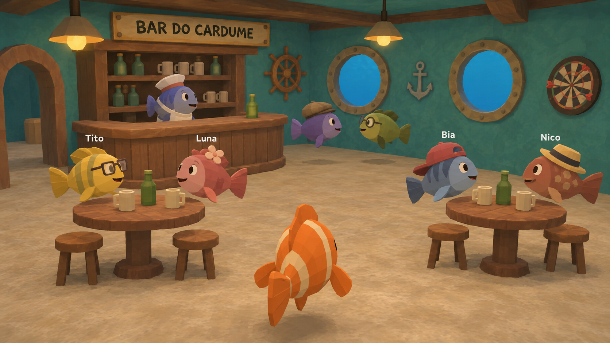

# 🐟 Kardume

*bons peixes, maus hábitos*

Um aquário social em 3D no navegador, para maiores de 18 anos. Cada jogador é um peixe (desenhado por ele mesmo) que nada, conversa, fica em pé e vai beber na adega com os amigos.



## O que tem na v0.1

- **Tela de login** no estilo colagem: carteirinha de sócio, cadastro com confirmação de 18+ e modo visitante, que só espia.
- **Contas reais**: usuário e senha com hash bcrypt, sessão em cookie httpOnly e "lembrar de mim" por 30 dias.
- **Desenhe seu peixe**: o desenho em 2D vira um peixe 3D "inflado". Também dá para escolher um dos 7 peixes prontos.
- **Duas salas multiplayer em tempo real**:
  - **Navio naufragado**: convés, porão com cofre, sino e garrafa com a mensagem do dia.
  - **Adega / Bar do Kardume**: balcão, Seu Garoupa (o barman), mesas, timão, escotilhas e alvo de dardos.
- **Chat em bolhas** sobre os peixes, com filtro de palavras.
- **Nadar / em pé**: com a tecla F aparecem perninhas de tênis. Na adega só se entra em pé.
- **Bebida tem consequência**: cada dose embaralha o que você digita. A partir de 3 doses dá soluço, o nado fica torto e a câmera balança. O efeito passa com o tempo.

## Rodando localmente

Requisitos: **Node 22.13+** (recomendado 24).

```bash
npm install
npm run dev
```

- Jogo: http://localhost:5173
- API/Socket: http://localhost:3000 (o Vite faz proxy de `/api` e `/socket.io`)

Para testar o multiplayer, abra uma janela anônima e crie outro peixe.

### Produção (um processo só)

```bash
npm run build   # compila o client em apps/client/dist
npm start       # servidor entrega API + socket + client em http://localhost:3000
```

Veja [docs/rodar-no-mac-mini.md](docs/rodar-no-mac-mini.md).

### Testes

```bash
npm test          # vitest: embaralhar texto, filtro, contorno do desenho, rotas de conta, segurança, schema
npm run typecheck # tsc nos três pacotes
```

## Segurança e privacidade

Resumo do que protege o Kardume e por quê. O jogo é **Vite + React** no navegador e **Fastify + Socket.IO + SQLite** no servidor; não há Supabase nem serviço de terceiros, então tudo abaixo vive neste repositório. O código de cada ponto tem um comentário curto explicando a decisão.

### 1. Cabeçalhos HTTP (`apps/server/src/seguranca.ts`)

Aplicados num hook `onRequest` do Fastify, ou seja, em **todas** as respostas: API, Socket.IO, arquivos do client, `index.html` e erros 404/500. O `vite.config.ts` importa a mesma função, então o `npm run dev` e o `vite preview` mandam os mesmos cabeçalhos (um lugar só para manter).

| Cabeçalho | Valor | Por quê |
|---|---|---|
| `Content-Security-Policy` | `default-src 'self'; script-src 'self'; style-src 'self' 'unsafe-inline'; img-src 'self' data: blob:; font-src 'self'; connect-src 'self'; worker-src 'self' blob:; object-src 'none'; base-uri 'self'; form-action 'self'; frame-ancestors 'none'` (+ `upgrade-insecure-requests` em produção com HTTPS) | Só roda código e carrega recursos do próprio site. |
| `Strict-Transport-Security` | `max-age=63072000; includeSubDomains; preload` | Só em produção **com** `CARDUME_HTTPS=1`. Em `http://localhost` prenderia o navegador em HTTPS. |
| `X-Content-Type-Options` | `nosniff` | O navegador não "adivinha" o tipo (um PNG de peixe nunca vira HTML). |
| `X-Frame-Options` | `DENY` | Reforço do `frame-ancestors` contra clickjacking em navegadores antigos. |
| `Referrer-Policy` | `strict-origin-when-cross-origin` | Outros sites não veem caminho nem query. |
| `Permissions-Policy` | `camera=(), microphone=(), geolocation=(), payment=(), usb=(), browsing-topics=()` | O jogo não usa nada disso; desliga para qualquer script. |
| `Cross-Origin-Opener-Policy` | `same-origin` | Isola a janela de popups de outros sites. |
| `Cross-Origin-Resource-Policy` | `same-origin` | Outros sites não embutem nossos PNGs/JSON. |
| `Cache-Control` | `no-store` nas rotas `/api/*` | Dados de conta nunca ficam em cache compartilhado (os PNGs de peixe ficam fora disso). |

**Sobre o CSP:**
- **`script-src 'self'` sem `'unsafe-inline'` em produção.** Diferente de um site Next.js, o build do Vite só gera `<script src="/assets/…">`; não existe script inline, então não precisamos nem de nonce nem de `'unsafe-inline'`. Em desenvolvimento o Vite injeta um preâmbulo inline do React Refresh, por isso o dev libera `'unsafe-inline' 'unsafe-eval'`, e só ele.
- **`style-src 'unsafe-inline'`** é necessário: o React aplica `style={…}` e o HUD usa variáveis CSS inline. CSS inline não executa código; o risco é muito menor que em scripts.
- **`img-src data: blob:`**: o editor desenha o peixe num canvas e as texturas viram `data:`/`blob:` URLs.
- **`connect-src 'self'`** cobre o `fetch('/api/…')` e o WebSocket do Socket.IO, que são da mesma origem (em dev o Vite faz proxy).

Fastify não manda `X-Powered-By` e o client já roda em `<StrictMode>`. O build sai **sem source maps** (`build.sourcemap: false`).

### 2. Nada externo carregado

- **Fontes** vêm de pacotes `@fontsource/*` (`apps/client/src/fontes.ts`) e são servidas pelo próprio site. Antes vinham do Google Fonts: cada visita mandava IP e página para o Google (ponto sensível na LGPD) e o CSP precisava liberar dois domínios.
- **Imagens** ficam em `apps/client/public` ou são geradas no navegador; nenhum domínio externo está liberado.
- O jogo não tem links externos nem JSON-LD hoje. Se surgirem: `target="_blank"` sempre com `rel="noopener noreferrer"`, texto em URL sempre com `encodeURIComponent` e JSON-LD gerado só da configuração com `<` escapado (`JSON.stringify(dados).replace(/</g, '\\u003c')`).
- O chat é texto puro: o servidor remove caracteres de controle e corta no limite, e o React escapa na tela. Nada usa `innerHTML`/`dangerouslySetInnerHTML`.

### 3. Segredos e variáveis de ambiente

- O projeto **não tem segredos**: sessões são tokens aleatórios de 256 bits, guardados no banco só como hash SHA-256; senhas, só como hash bcrypt.
- `.env` e `.env.*` ficam fora do Git; só o **`.env.example`** (sem valores reais) é versionado. `*.pem`, `*.key` e o banco (`data/*.db`) também são ignorados.
- O Vite só expõe ao navegador variáveis com prefixo `VITE_`. **Nunca** crie `VITE_` com algo sensível. As variáveis do servidor (`CARDUME_*`) não têm esse prefixo, então não chegam ao client.
- Dependabot (`.github/dependabot.yml`) abre PRs semanais com atualizações de dependências.

Variáveis de segurança (detalhes no `.env.example`):

| Variável | Efeito |
|---|---|
| `CARDUME_HTTPS=1` | Liga HSTS, cookie `Secure` e `upgrade-insecure-requests`. Use só quando o site é acessado por HTTPS. |
| `CARDUME_TRUST_PROXY` | IP do proxy confiável (ex.: `127.0.0.1` com cloudflared). Sem isso, `X-Forwarded-*` é ignorado e ninguém falsifica IP para fugir do limite de tentativas. |
| `CARDUME_ORIGENS` | Origens extras aceitas em escrita e WebSocket, se o domínio público for diferente do `Host` que chega no servidor. |
| `HOST=127.0.0.1` | Recomendado atrás de proxy/túnel, para o Node não ficar exposto direto na rede. |

### 4. Banco de dados e isolamento por conta (o papel do RLS)

O SQLite não tem Row Level Security como o Postgres/Supabase, porque não tem usuários nem papéis: quem abre o arquivo lê tudo. Por isso a mesma garantia do RLS ("cada um só vê e altera o que é seu") é aplicada em camadas:

1. **Só o servidor abre o banco.** O navegador nunca fala com o SQLite, não existe chave de banco no client e o arquivo fica fora das pastas servidas.
2. **Toda rota de conta usa o usuário da sessão.** `exigirUsuario()` lê o cookie, confere o token no banco e devolve a conta. Nenhuma rota aceita id de usuário vindo do corpo, da URL ou do client, e todo `UPDATE`/`DELETE` filtra por esse id (`WHERE id = ?`).
3. **Leitura pública mínima:** só `/api/peixe/:id.png`, o desenho que todos já veem no aquário. Nome e aparência dos outros chegam pelo Socket.IO, nunca e-mail ou dados de conta.
4. **Testado:** em `auth.test.ts`, uma conta tenta alterar outra mandando o id dela no corpo e só consegue alterar a si mesma. A exportação traz só a conta da sessão, e sem sessão tudo responde `401`.

- **Arquivo protegido:** pasta criada com `0700` e arquivo com `0600` (só o usuário do sistema que roda o servidor lê). No Windows vale a permissão da pasta.
- `PRAGMA foreign_keys = ON` (sessões somem com a conta), `trusted_schema = OFF` (nada no schema roda com privilégio extra) e `secure_delete = ON` (sessões e hashes apagados são zerados no arquivo).
- **Limites no próprio banco** (`aplicarRestricoes` em `db.ts`): triggers recusam nome fora de 3–20 caracteres ou com caracteres proibidos, hash de senha fora do formato bcrypt, e-mail com mais de 254 caracteres ou sem `@`, PNG, contorno, modelo e roupa acima do tamanho, e token de sessão que não seja um hash hex de 64 caracteres. Assim um bug numa rota não consegue gravar lixo. São triggers (e não `CHECK`) porque o SQLite não deixa adicionar `CHECK` a tabelas existentes; elas são recriadas a cada início, então mudar um limite vale também para bancos antigos.
- **Unicidade:** nome de peixe único sem diferenciar maiúsculas, e e-mail único (`users_email`, também sem diferenciar maiúsculas).
- **Testado** em `db.test.ts`: aplicar o schema três vezes no mesmo arquivo sem erro; valores inválidos, nome e e-mail repetidos e token cru recusados; e as sessões apagadas junto com a conta. O banco atual (`data/cardume.db`) passa em todas as regras.
- Todas as consultas usam `prepare(...)` com parâmetros, nunca SQL montado com texto do usuário.

### 5. Privacidade (LGPD)

- **Páginas públicas:** [`/privacidade.html`](apps/client/public/privacidade.html), [`/cookies.html`](apps/client/public/cookies.html) e [`/termos.html`](apps/client/public/termos.html). São estáticas, sem scripts e com o mesmo CSP, e ficam linkadas no rodapé do login, no cadastro e no Camarim. **Antes de publicar, troque `[e-mail de contato do time]` nas páginas pelo e-mail real.**
- **Aviso de cookies** (`AvisoCookies.tsx`): é informativo, não um pedido de consentimento. O jogo só usa o cookie essencial de sessão e preferências locais, o que a LGPD permite sem consentimento. Se algum dia entrar analytics ou outro cookie não essencial, o aviso precisa virar escolha de aceitar ou recusar, com recusa por padrão.
- **Direitos do titular, sem depender do time:**
  - `GET /api/me/dados`: baixa um JSON com tudo o que existe da conta (Camarim → Conta → Baixar meus dados).
  - `DELETE /api/me`: exclui a conta, pedindo a senha de novo. As sessões caem junto e o socket é derrubado (Camarim → Conta → Excluir minha conta).
  - Correção de nome, e-mail e senha no próprio Camarim.
- **Minimização:** não guardamos idade, documento nem telefone. Chat, posição e IP ficam só na memória do servidor.

### 6. Contas e sessão

- **Senhas:** bcrypt; mínimo de **8** caracteres (NIST SP 800-63B; só vale para senhas novas). Máximo de **72 bytes**, porque o bcrypt ignora o resto e cortaria a senha sem avisar.
- **Cookie `cardume_sessao`:** `HttpOnly` (o JavaScript não lê o token), `SameSite=Lax` (não vai em POST, fetch ou WebSocket vindos de outros sites), `Path=/` e `Secure` com `CARDUME_HTTPS=1`. Sessão de 1 dia, ou 30 com "lembrar".
- **CSRF e "cross-site WebSocket hijacking":** além do `SameSite`, todo `POST/PUT/PATCH/DELETE` em `/api/*` e todo handshake do Socket.IO conferem `Origin` (ou `Sec-Fetch-Site`) contra o host. Outro site recebe `403`. O modo dev antes refletia qualquer origem com credenciais no Socket.IO; isso foi removido.
- **Toda rota e todo evento conferem a sessão no servidor:** `exigirUsuario()` nas rotas `/api/me/*` e a leitura do cookie no handshake do socket. O client nunca decide quem está logado.
- **Login:** a mesma mensagem ("Usuário ou senha não conferem.") para conta inexistente e senha errada, e com o mesmo tempo de resposta (bcrypt contra um hash falso). Limites: 10 tentativas/min por IP, 120/min no total e **10 falhas por conta a cada 15 min**. Conta inexistente também acumula falhas, então o `429` não revela quem existe. O client mostra a mensagem de `429`.
- **Trocar senha** exige a atual, derruba as outras sessões e tem limite de 5 tentativas a cada 10 min.
- **Logout** apaga a sessão no banco, derruba o socket dela e limpa o cookie.
- **Erros:** respostas 5xx nunca levam stack ou mensagem do banco ("Algo deu errado do nosso lado"), e JSON malformado ou corpo grande demais recebem mensagens genéricas.
- **Corpo das requisições:** 32 KB por padrão. Só o envio do desenho do peixe aceita até 600 KB, e o PNG é conferido (assinatura e dimensões exatas) para barrar "bombas" de imagem.
- **Excluir a conta** exige a senha e usa o mesmo limite de tentativas da troca de senha.
- Não existe painel de administração. Se surgir um, ele deve seguir o mesmo modelo: checagem no servidor em toda rota (nunca só no client), tabela de admins no banco e sessão encerrada para quem não está nela.

### Checklist antes de publicar

- [ ] `NODE_ENV=production`, `CARDUME_HTTPS=1` (se houver HTTPS), `CARDUME_TRUST_PROXY` com o IP do túnel e `HOST=127.0.0.1`.
- [ ] `npm audit` sem vulnerabilidades altas, e PRs do Dependabot revisados.
- [ ] Testar em https://securityheaders.com e no console do navegador (nenhum erro de CSP).
- [ ] Backup do `data/cardume.db` guardado com as mesmas permissões restritas.
- [ ] E-mail de contato real nas páginas de privacidade e termos.

## Controles

| Tecla | Ação |
| --- | --- |
| W A S D / setas | nadar (relativo à câmera) |
| Espaço / Shift | subir / descer |
| F | ficar em pé ↔ nadar |
| E | interagir (porta, balcão, sino, garrafa) |
| Enter | falar no chat |
| Clique no chão | nadar até o ponto |
| Arrastar / roda | girar câmera / zoom |

## Estrutura

```
packages/shared   protocolo, constantes das salas, embaralharTexto, filtro de palavras
apps/server       Fastify + Socket.IO + SQLite (node:sqlite): contas, salas, chat, bebida
apps/client       React + three.js (react-three-fiber): login, editor, mundo 3D, HUD
docs/             game design, estilo visual, referências, como rodar no Mac mini
data/             banco SQLite (fora do git) e lista extra de palavras bloqueadas
```

## Documentos

- [docs/game-design.md](docs/game-design.md): o que é o jogo, o que entrou na v0.1 e ideias para as próximas versões.
- [docs/estilo-visual.md](docs/estilo-visual.md): regras do visual low-poly e da interface colagem.
- [docs/resumo-do-projeto.md](docs/resumo-do-projeto.md): resumo original das conversas do grupo.
